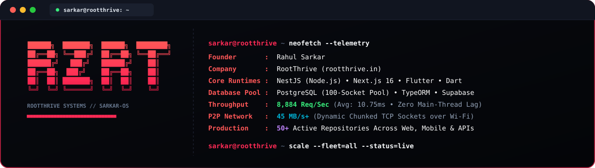
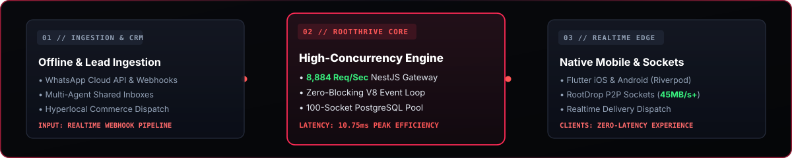
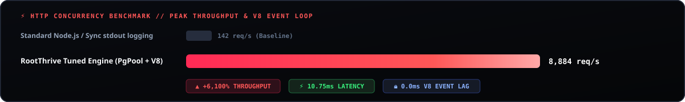
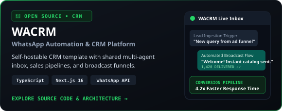
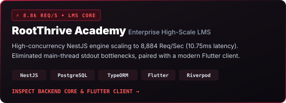
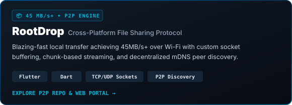
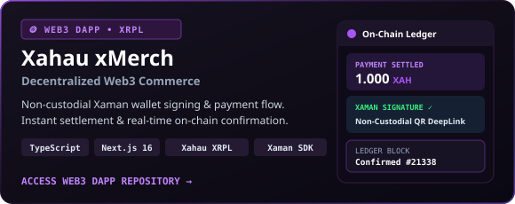

  <!-- 🚀 Custom Cybernetic 3D Hero Command Center -->
  

    

  <!-- 🔥 Dynamic Real-Time Typing Animation -->
  

   

  <!-- 🛡️ Metric & Status Badges -->
  
  
  
  

 

<!-- 🖥️ macOS Cyber Terminal Window -->

  

 

## 🏗️ Systems Architecture Blueprint

An end-to-end telemetry view of how I connect offline business logistics, high-throughput microservices, and cross-platform native interfaces:

  

 

## ⚡ Concurrency & Performance Engine Diagnostics

Benchmarking V8 event loop optimization and PostgreSQL pool allocation under heavy load:

  

 

## 🚀 Featured Systems & Open-Source Repositories

<table border="0" cellpadding="0" cellspacing="0" width="100%">
  <tr>
    <td width="50%" align="center" valign="top">
      
    </td>
    <td width="50%" align="center" valign="top">
      
    </td>
  </tr>
  <tr>
    <td width="50%" align="center" valign="top">
      
    </td>
    <td width="50%" align="center" valign="top">
      
    </td>
  </tr>
</table>

 

<b>🏢 RootThrive Production Fleet (50+ Repositories &amp; Microservices)</b> — <i>Click to Expand</i>

 

<table width="100%">
  <thead>
    <tr>
      <th align="left">Domain</th>
      <th align="left">Production Systems</th>
      <th align="left">Architecture &amp; Core Stack</th>
      <th align="left">Business Impact</th>
    </tr>
  </thead>
  <tbody>
    <tr>
      <td><strong>🛒 Hyperlocal &amp; Delivery</strong></td>
      <td><code>Door2Door</code> • <code>VivBazaar</code> • <code>Biswas Market</code></td>
      <td>Flutter (iOS &amp; Android), Web Admin, Blade, PostGIS</td>
      <td>End-to-end multi-vendor commerce with real-time dispatch &amp; cart checkout</td>
    </tr>
    <tr>
      <td><strong>💼 Workforce &amp; Services</strong></td>
      <td><code>Kaajsathi Core</code> • <code>Kaajsathi Client</code></td>
      <td>TypeScript, Node.js, WebSockets, FCM Push</td>
      <td>On-demand workforce matching engine connecting local businesses &amp; workers</td>
    </tr>
    <tr>
      <td><strong>⚡ P2P &amp; Systems</strong></td>
      <td><code>RootDrop</code> • <code>RootDrop Portal</code></td>
      <td>Flutter, Dart, Custom TCP/UDP Sockets</td>
      <td>High-speed parallel chunk transfer (45MB/s+) eliminating cloud storage cost</td>
    </tr>
    <tr>
      <td><strong>💬 Sales &amp; Automation</strong></td>
      <td><code>WACRM</code></td>
      <td>Next.js 16, TypeScript, WhatsApp Cloud API</td>
      <td>Direct-response customer conversion pipelines &amp; automated notification flows</td>
    </tr>
  </tbody>
</table>

 

<b>🛡️ Systems Engineering &amp; Architectural Guardrails</b> — <i>Click to Expand</i>

 

*   **🏗️ Clean Architecture &amp; DDD**: Strict layer decoupling ensures business logic remains completely independent from web frameworks and database adapters.
*   **⚡ Zero Main-Thread Blocking**: Strict V8 and Dart runtime audits guarantee all intensive computation, file transforms, and I/O are offloaded, preserving full event-loop responsiveness.
*   **🔒 Zero-Trust Security**: Whitelisted origins, cryptographic JWT verification, query sanitization, and automated secret-detection pipelines.
*   **🏊 Proactive Connection Pool Tuning**: PostgreSQL sockets scaled to 100 handles, kernel TCP buffers configured for maximum burst concurrency.

 

## ⚙️ Systems Engineering Tech Matrix

<table align="center" width="100%">
  <tr>
    <td align="center" valign="top" width="33.3%">
      <h3>🌐 Frontend &amp; UI</h3>
      
        
      <code>Next.js 16</code> • <code>React</code> • <code>TailwindCSS</code> 
      <code>TypeScript</code> • <code>Figma UI/UX</code>
    </td>
    <td align="center" valign="top" width="33.3%">
      <h3>⚡ Backend &amp; Database</h3>
      
        
      <code>NestJS</code> • <code>Node.js</code> • <code>PostgreSQL</code> 
      <code>TypeORM</code> • <code>Supabase</code> • <code>Firebase</code>
    </td>
    <td align="center" valign="top" width="33.3%">
      <h3>📱 Mobile &amp; DevOps</h3>
      
        
      <code>Flutter</code> • <code>Dart</code> • <code>Riverpod</code> 
      <code>Docker</code> • <code>Linux</code> • <code>CI/CD Actions</code>
    </td>
  </tr>
</table>

 

## 🐍 Activity Snake & Live Telemetry

  

 

<table align="center" border="0" cellpadding="0" cellspacing="0" width="100%">
  <tr>
    <td align="center" valign="top" width="50%">
      
    </td>
    <td align="center" valign="top" width="50%">
      
    </td>
  </tr>
  <tr>
    <td colspan="2" align="center" valign="top">
       
      
    </td>
  </tr>
</table>

 

## 📬 Connect & Transmit

Ready to scale your business infrastructure, engineer custom high-throughput platforms, or deploy automated WhatsApp workflows?

  
  
  
  

  

  <strong>"I design systems that power entire businesses, not just applications."</strong>

