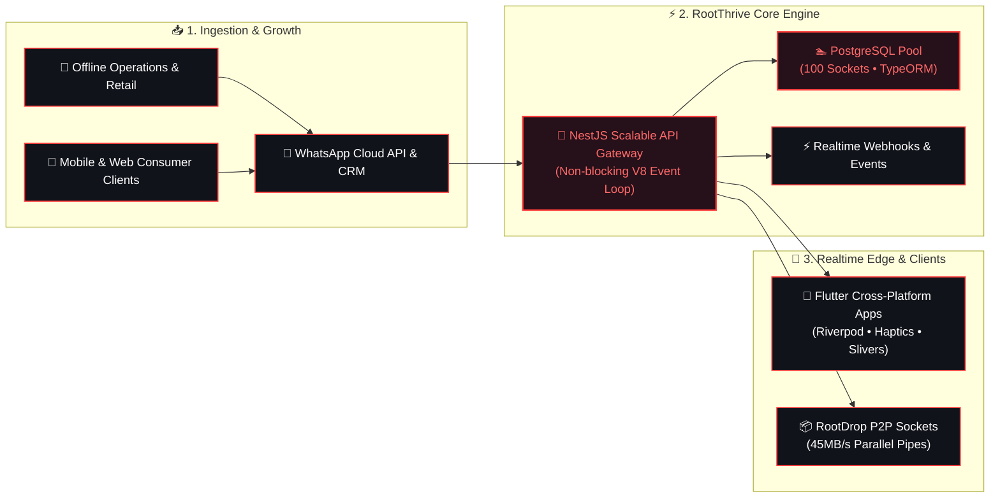

<div align="center">
  <!-- 🚀 Custom Cybernetic Hero Command Center Banner -->
  <a href="https://rootthrive.in">
    
  </a>

  <br /><br />

  <!-- 🔥 Dynamic Real-Time Typing Animation -->
  <a href="https://rootthrive.in">
    
  </a>

  <br />

  <!-- 🛡️ Metric & Status Badges -->
  <a href="https://rootthrive.in">
    
  </a>
  
  
  
</div>

<p align="center">
  
</p>

```text
  ██████╗  ███████╗  ██████╗  ████████╗   rahul@rootthrive-core
  ██╔══██╗ ╚══███╔╝  ██╔══██╗ ╚══██╔══╝   ─────────────────────────────────────────────
  ██████╔╝   ███╔╝   ██████╔╝    ██║      Role: Founder & Systems Architect @ RootThrive
  ██╔══██╗  ███╔╝    ██╔══██╗    ██║      OS: macOS Sonoma / Debian Linux
  ██║  ██║ ███████╗  ██║  ██║    ██║      Runtimes: V8 (Node/Nest) • Dart AOT • Flutter
  ╚═╝  ╚═╝ ╚══════╝  ╚═╝  ╚═╝    ╚═╝      Database: PostgreSQL (100-socket connection pools)
                                          Throughput: 8,884 req/s @ 10.75ms avg latency
                                          Core Focus: Hyperlocal Delivery, CRMs & P2P Protocols
                                          Status: Deploying scalable revenue engines 🚀
```

<p align="center">
  
</p>

## 🏗️ Systems Architecture Blueprint

How I bridge offline business logistics, high-throughput microservices, and cross-platform native interfaces:



<p align="center">
  
</p>

## ⚡ Throughput & Performance Benchmarks

```text
┌────────────────────────────────────────────────────────────────────────┐
│ ⚡ HTTP CONCURRENCY BENCHMARK (Requests / Second)                      │
├────────────────────────────────────────────────────────────────────────┤
│ Standard Monolith / Sync stdout  ░░░░ 142 req/s  (V8 Event-Loop Lag)   │
│ RootThrive Optimized Engine      ████████████████ 8,884 req/s (10.75ms)│
├────────────────────────────────────────────────────────────────────────┤
│ Result: +6,100% Throughput Boost • Zero Event-Loop Starvation          │
└────────────────────────────────────────────────────────────────────────┘
```

<p align="center">
  
</p>

## 🚀 Featured Systems & Open-Source Repositories

<table width="100%">
  <tr>
    <td width="50%" valign="top">
      <h3>💬 <a href="https://github.com/rahul-sarkar-tech/wacrm">WACRM — WhatsApp CRM &amp; Automation</a></h3>
      <p>Self-hostable CRM template built for WhatsApp Business automation. Features a shared multi-agent inbox, contact segmentation, sales pipelines, broadcast campaigns, and automated trigger workflows.</p>
      <p>
        
        
        
        
      </p>
      <p>➔ <a href="https://github.com/rahul-sarkar-tech/wacrm"><strong>Explore Source Code &amp; Architecture »</strong></a></p>
    </td>
    <td width="50%" valign="top">
      <h3>⚡ <a href="https://github.com/rahul-sarkar-tech/rootthrive-coaching-app-backend">RootThrive Academy LMS Suite</a></h3>
      <p>High-concurrency e-learning engine benchmarked at <strong>8,884 Req/Sec</strong> (10.75ms latency). Built with NestJS, TypeORM, and PostgreSQL connection pooling, paired with a modern Flutter mobile client.</p>
      <p>
        
        
        
        
      </p>
      <p>➔ <a href="https://github.com/rahul-sarkar-tech/rootthrive-coaching-app-frontend"><strong>Frontend Client</strong></a> | <a href="https://github.com/rahul-sarkar-tech/rootthrive-coaching-app-backend"><strong>Backend Core »</strong></a></p>
    </td>
  </tr>
  <tr>
    <td width="50%" valign="top">
      <h3>📦 <a href="https://github.com/rahul-sarkar-tech/rootdrop">RootDrop P2P Transfer Engine</a></h3>
      <p>High-speed, privacy-first peer-to-peer file sharing protocol. Reaches <strong>45MB/s+</strong> local transfer over 5GHz Wi-Fi with custom socket pooling, chunk-based streaming, and mDNS peer discovery.</p>
      <p>
        
        
        
        
      </p>
      <p>➔ <a href="https://github.com/rahul-sarkar-tech/rootdrop"><strong>P2P Engine</strong></a> | <a href="https://github.com/rahul-sarkar-tech/rootdrop-website"><strong>Web Portal »</strong></a></p>
    </td>
    <td width="50%" valign="top">
      <h3>🪙 <a href="https://github.com/rahul-sarkar-tech/xahau-xmerch-demo">Xahau xMerch Web3 DApp</a></h3>
      <p>Decentralized Web3 commerce application on the Xahau Network. Features non-custodial Xaman wallet signing (QR / deep link), instant testnet settlement, and real-time on-chain ledger confirmation.</p>
      <p>
        
        
        
        
      </p>
      <p>➔ <a href="https://github.com/rahul-sarkar-tech/xahau-xmerch-demo"><strong>Explore DApp Repository »</strong></a></p>
    </td>
  </tr>
</table>

<p align="center">
  
</p>

## 🏢 RootThrive Production Fleet

An overview of business-critical systems engineered and deployed across 50+ repositories:

<table width="100%">
  <thead>
    <tr>
      <th align="left">Domain</th>
      <th align="left">Production Systems</th>
      <th align="left">Architecture &amp; Core Stack</th>
      <th align="left">Business Impact</th>
    </tr>
  </thead>
  <tbody>
    <tr>
      <td><strong>🛒 Hyperlocal &amp; Delivery</strong></td>
      <td><code>Door2Door</code> • <code>VivBazaar</code> • <code>Biswas Market</code></td>
      <td>Flutter (iOS &amp; Android), Web Admin, Blade, PostGIS</td>
      <td>End-to-end multi-vendor commerce with real-time dispatch &amp; cart checkout</td>
    </tr>
    <tr>
      <td><strong>💼 Workforce &amp; Services</strong></td>
      <td><code>Kaajsathi Core</code> • <code>Kaajsathi Client</code></td>
      <td>TypeScript, Node.js, WebSockets, FCM Push</td>
      <td>On-demand workforce matching engine connecting local businesses &amp; workers</td>
    </tr>
    <tr>
      <td><strong>⚡ P2P &amp; Systems</strong></td>
      <td><code>RootDrop</code> • <code>RootDrop Portal</code></td>
      <td>Flutter, Dart, Custom TCP/UDP Sockets</td>
      <td>High-speed parallel chunk transfer (45MB/s+) eliminating cloud storage cost</td>
    </tr>
    <tr>
      <td><strong>💬 Sales &amp; Automation</strong></td>
      <td><code>WACRM</code></td>
      <td>Next.js 16, TypeScript, WhatsApp Cloud API</td>
      <td>Direct-response customer conversion pipelines &amp; automated notification flows</td>
    </tr>
  </tbody>
</table>

<p align="center">
  
</p>

## 🛡️ Systems Engineering & Architectural Guardrails

*   **🏗️ Clean Architecture & DDD**: Strict layer decoupling ensures business logic remains independent from frameworks and database adapters.
*   **⚡ Zero Main-Thread Blocking**: Strict V8 and Dart runtime audits ensure all intensive computation and I/O are offloaded, preserving full event-loop responsiveness.
*   **🔒 Zero-Trust Security**: Whitelisted origins, cryptographic JWT verification, input sanitization, and automated secret-detection pipelines.
*   **🏊 Proactive Pool Tuning**: PostgreSQL sockets scaled to 100 handles, kernel TCP buffers configured for maximum burst concurrency.

<p align="center">
  
</p>

## ⚙️ Systems Engineering Tech Matrix

<table align="center" width="100%">
  <tr>
    <td align="center" valign="top" width="33.3%">
      <h3>🌐 Frontend &amp; UI</h3>
      
      <br /><br />
      <code>Next.js 16</code> • <code>React</code> • <code>TailwindCSS</code><br />
      <code>TypeScript</code> • <code>Figma UI/UX</code>
    </td>
    <td align="center" valign="top" width="33.3%">
      <h3>⚡ Backend &amp; Database</h3>
      
      <br /><br />
      <code>NestJS</code> • <code>Node.js</code> • <code>PostgreSQL</code><br />
      <code>TypeORM</code> • <code>Supabase</code> • <code>Firebase</code>
    </td>
    <td align="center" valign="top" width="33.3%">
      <h3>📱 Mobile &amp; DevOps</h3>
      
      <br /><br />
      <code>Flutter</code> • <code>Dart</code> • <code>Riverpod</code><br />
      <code>Docker</code> • <code>Linux</code> • <code>CI/CD Actions</code>
    </td>
  </tr>
</table>

<p align="center">
  
</p>

## 📊 Live GitHub Diagnostics & Telemetry

<table align="center" border="0" cellpadding="0" cellspacing="0" width="100%">
  <tr>
    <td align="center" valign="top" width="50%">
      
    </td>
    <td align="center" valign="top" width="50%">
      
    </td>
  </tr>
  <tr>
    <td colspan="2" align="center" valign="top">
      <br />
      
    </td>
  </tr>
</table>

<p align="center">
  
</p>

## 📬 Connect & Collaborate

Ready to scale your business infrastructure, engineer custom high-throughput platforms, or deploy automated WhatsApp workflows?

<div align="center">
  <a href="https://www.linkedin.com/in/rahul-rootthrive/">
    
  </a>
  <a href="https://rootthrive.in">
    
  </a>
  <a href="https://rahul-sarkar.vercel.app">
    
  </a>
  <a href="mailto:rootthrive.business@outlook.in">
    
  </a>
</div>

<br />

<p align="center">
  
</p>

<div align="center">
  <strong>"I design systems that power entire businesses, not just applications."</strong>
</div>
